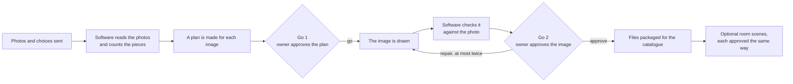

# Midas Studio: what it is and how a job works

*Business documentation · status as of 21 Oct 2026*

## In one paragraph

Midas Studio turns a supplier's product photo into catalogue images for Midas Furniture. These are a clean product shot on white and, if wanted, the product shown in a styled room. The studio owner checks and approves every image before it is used. Software does the reading, planning, drawing and checking. Every decision that matters, and every spend, stays with the owner.

## Who uses it

| Who | What they do |
|---|---|
| **Studio owner** | Starts jobs, approves the plan and the image, decides on repairs, sets spending limits |
| **In-house team / client page** | Sends product photos and choices. The client pages are drafts and not live yet |
| **Customers** | Never use the studio, which is private. Approved images are meant for the Midas selling catalogue |

## What it produces

- **White catalogue image.** The product alone on pure white, centred, at a fixed size (1125×1125). Delivered as JPG and WebP with a record of how it was made.
- **Room scenes, optional.** The same product in a styled room. Only Midas accessories that are in stock are used, at most three per scene.
- Every result is labelled "Generated image". It is called "Approved" only after the owner approves it.

## How a job works

**Safety built in**

- **It holds when unsure.** If the photo is cropped or unclear, or the counts disagree, the job stops and asks; it never invents parts of a product.
- **Every paid step reserves money first.** If the money is not reserved, nothing is spent. The image step is never retried automatically, and a step with an unclear outcome is never sent again, so nothing is paid for twice by accident.
- **The owner decides to the end.** A passed check is only a suggestion. The owner still decides.

## Where it runs

- **The owner app** is a private website with invite-only sign-in.
- **The engine** is the part that runs jobs. It was first built in n8n, an automation tool, and is being moved into the project's own Python service.
  - Since 20 Oct 2026 the preview owner site uses the new service.
  - The second owner site still uses n8n.
  - See [status and roadmap](claude-status.md).

The detailed owner-facing review, with diagrams, is in `docs/claude-midas-studio-review/`.
