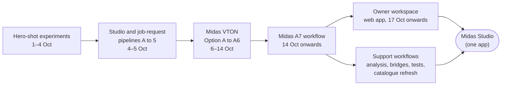
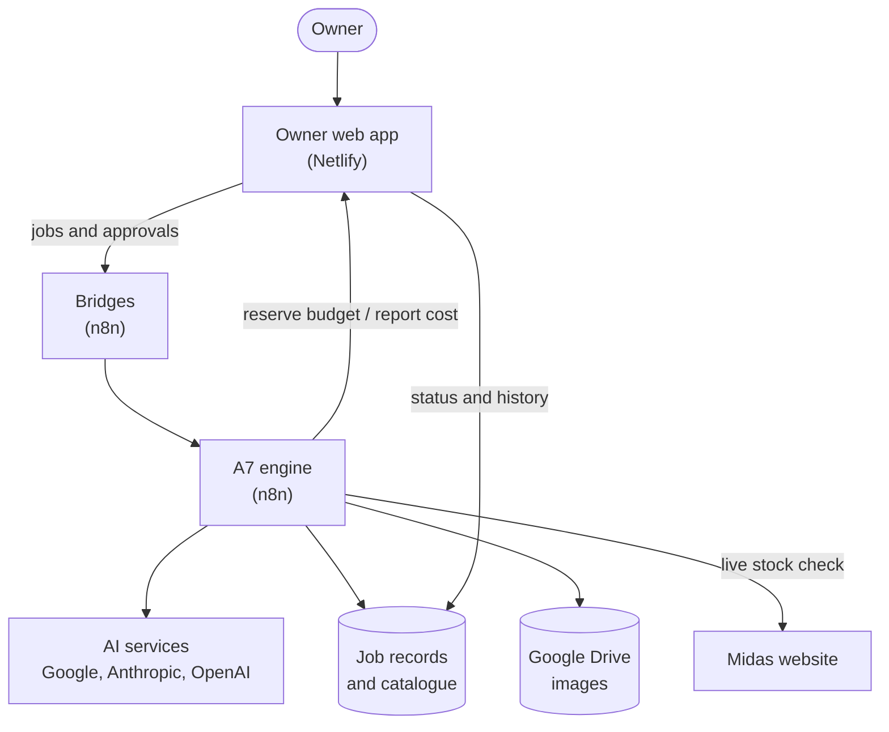
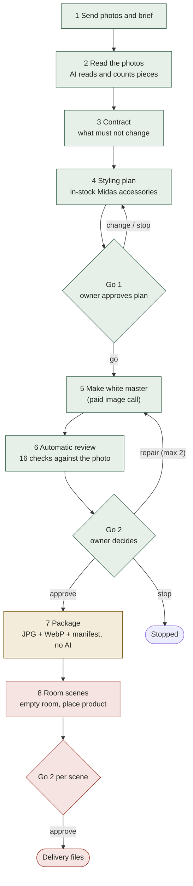
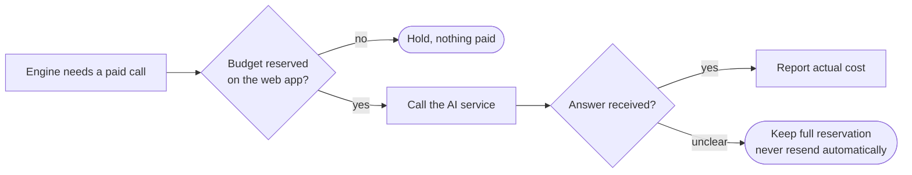

# Midas Studio review: diagrams

The diagrams used in the review page (20 Oct 2026). Green means proven on real jobs, amber means proven once with manual help, red means never proven live.

## How the names relate in time

## How the parts connect

## The product image journey

## How a paid call is guarded

