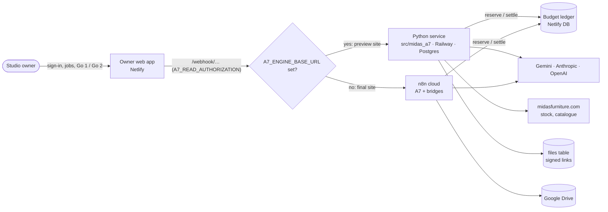

# Architecture

*Technical documentation · checked against commit `2bd6550` (21 Oct 2026)*

## The system in one picture

## Components

| Component | Where | Role |
|---|---|---|
| **A7 workflow logic** | `n8n/baseline/*.json` | Seven n8n workflows: the main one (stages 01–07, 151 Code nodes) plus the owner bridges, source analysis, model tests and catalogue refresh |
| **Python service** | `src/midas_a7/` | Runs those seven workflows from frozen packages: same webhook paths and contracts, Code-node JS run unchanged in a Node sidecar. See [claude-python-service.md](claude-python-service.md) |
| **Owner web app** | `claude-outputs/claude-midas-a7-owner-workspace/` | Invite-only owner UI and Netlify functions: auth, job intake, Go 1/Go 2, budget ledger, catalogue import, model tests. See [claude-owner-app.md](claude-owner-app.md) |
| **Client page drafts** | `claude-outputs/claude-midas-a7-page`, `-page-2`, `-page-3` | Customer-facing studio drafts; mock mode only, not connected |
| **a7-engine (paused)** | `services/a7-engine/` | Earlier Python re-implementation of source analysis only. Not deployed, superseded by `src/midas_a7` |

## Which engine serves which site

| Owner site | `A7_ENGINE_BASE_URL` | Engine |
|---|---|---|
| `midas-a7-owner-preview` | `https://midas-a7-production.up.railway.app` (set 20 Oct 2026) | Python service |
| `claude-final-midas-a7` | unset | n8n (`ibrahimnewaeon.app.n8n.cloud`) |

Source: `claude-outputs/claude-midas-a7-owner-workspace/SETTINGS.md`. To roll back, delete the variable and redeploy the site. Runs already started on the service do not move back.

## Request path for one job

1. The owner submits photos and options in the owner app. The function `/api/owner/submissions` stores the originals privately (Netlify Blobs) and forwards the job to `POST /webhook/a7/owner-submit`.
2. The bridge flow validates the job and calls the main flow `POST /webhook/claude-midas-a7`.
3. The main flow reads the photos, plans the shots and parks at **Go 1**, waiting up to 24 h.
4. The owner decides. The decision goes to `/api/owner/jobs/:id/approval`, then `a7/owner-decision`, then `claude-midas-a7-decision`, which resumes the run.
5. The flow draws the white master, reviews it and parks at **Go 2**. Approval leads to the package (step 18) and optionally scenes (step 19) and scene files (step 20).
6. Before each paid model call, the flow reserves budget on the owner site (`/api/a7/budget/reserve`) and settles it afterwards.
7. The owner app reads status through `GET /webhook/a7/owner-read`.

## Authentication

| Hop | Mechanism |
|---|---|
| Owner, then site | Netlify Identity, invite-only, `owner` role. HttpOnly session cookies. `/owner/*` is gated in `netlify.toml` |
| Site, then engine | `A7_READ_AUTHORIZATION` sent as a header. The service checks it against `A7_BRIDGE_HEADER_VALUE` |
| Engine, then budget ledger | Same shared value, production context only |
| Resume and file links | HMAC-signed: resume links with `RESUME_SIGNING_SECRET`; file links with `FILE_LINK_SECRET` when set, else `RESUME_SIGNING_SECRET` (Python service; links signed with the resume secret keep opening) |

## Data

| Data | n8n | Python service |
|---|---|---|
| Runs, vault, catalogue, handling profiles, model registry, operations, identity | n8n data tables (ids in `n8n/baseline/data-tables.json`) | `dt_rows` table; schemas in `src/midas_a7/data/data-tables.json`; three tables seeded on first start |
| Images and packages | Google Drive ("Claude · Midas A7 images") | `files` table, signed links. Drive was dropped on 20 Oct 2026 |
| Parked runs | n8n executions | `executions` table |
| Budget ledger, drafts, references | Owner site: Netlify Database, 10 migrations | same (unchanged) |

The Python service started fresh on 20 Oct 2026: no run or file history was migrated.
